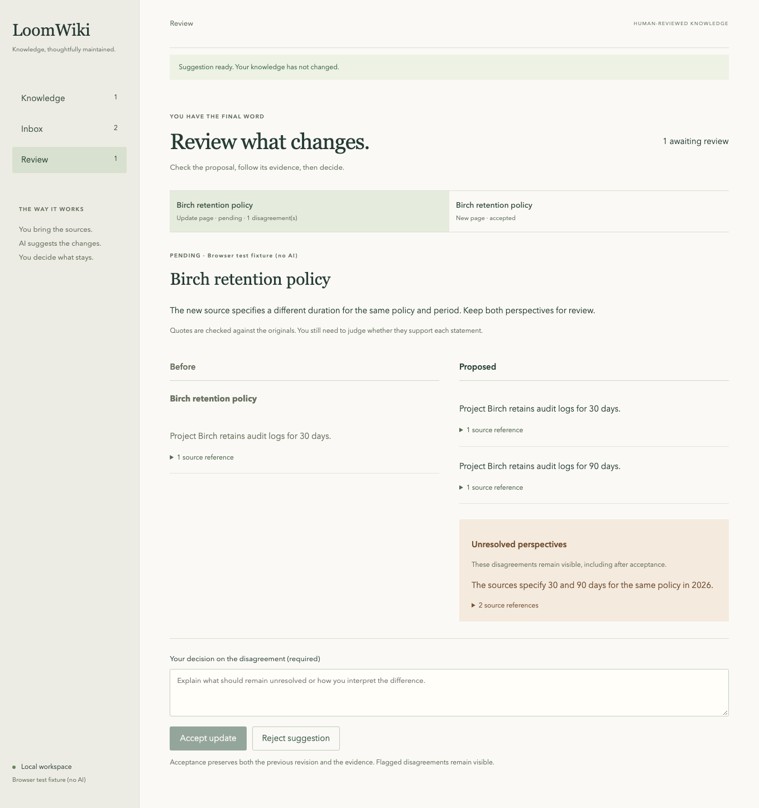

# LoomWiki

[](https://github.com/hopesoft/loomwiki/actions/workflows/ci.yml)

**An AI-maintained knowledge base, reviewed by you.**

Bring in information. AI proposes how your knowledge should change. Review the evidence, accept what helps, and keep the history of every decision.

## The workflow

1. **Inbox:** import Markdown or paste text. Original sources are preserved locally.
2. **Prepare a review:** send a selected source and the current knowledge context to the configured model provider. AI proposes one new page or an update to an existing page.
3. **Review:** compare before and proposed content, inspect original quotes, and accept or reject.
4. **Knowledge:** read accepted pages and their revision history. No proposal changes a page before acceptance.

This is a local, single-user Web prototype. It is not a hosted multi-user service. Model suggestions are not established facts: exact-quote validation checks provenance, not whether the evidence logically supports a claim.

## Run locally

Requires Node.js 22.19+ with `node:sqlite`, pnpm 10.12.2, and Make. Node 22.19.0 is exercised locally and in the CI matrix; Node 24 is the recommended development line.

```sh
make install
cp .env.example .env
# Edit .env locally and set LOOMWIKI_API_KEY. Never share or commit this file.
chmod 600 .env
make dev
```

Open **http://127.0.0.1:4310**. `make dev` builds once and starts the server. Restart after code or configuration changes. Stop an earlier instance before starting another. `PORT=4311 make dev` selects another port; the library lock rejects a second process using the same state directory, even on a different port. Stop older pre-lock versions before upgrading.

The first launch does not contact a model. Importing sources is local. The Inbox action explicitly sends the selected source and current page context to the configured provider. The API key remains in the backend. `.env` is ignored by Git and is not a static Web asset.

The example uses OpenAI Chat Completions with `gpt-4.1`. Set `LOOMWIKI_PROVIDER`, `LOOMWIKI_MODEL`, `LOOMWIKI_MODEL_URL`, and the matching `LOOMWIKI_API_KEY` together to switch providers. DeepSeek remains supported; alternative settings are listed in `.env.example`. Both use JSON output, a 6,000-token completion budget, a 60-second timeout, and no automatic retries. DeepSeek disables thinking; OpenAI receives no DeepSeek-specific parameters.

For backward compatibility, configurations without `LOOMWIKI_PROVIDER` retain DeepSeek defaults, except an explicit `api.openai.com` endpoint selects OpenAI. Custom compatible endpoints should set the provider explicitly. Existing `.env` files are not migrated automatically. Requests can incur provider charges.

Without a key, import and inspection still work; processing is disabled with configuration guidance. There is no fake AI fallback.

## Try the loop

Import `fixtures/retention-policy.md` in Inbox and choose **Send to AI & prepare review**. Inspect the suggestion in Review, then accept it. Import `fixtures/revised/retention-policy.md` and process it. The model should propose an update to the existing policy page and identify the differing retention periods. Review both sources before accepting or rejecting.

The policy fixtures are synthetic. Different retention periods alone do not always mean contradiction; context and effective periods matter. This workflow is an evaluation example, not a promise that every model response is correct.

## Commands

| Command | Purpose |
| --- | --- |
| `make help` | List development commands |
| `make install` | Install locked dependencies |
| `make dev` | Build once and start locally |
| `make start` | Start using an existing build |
| `make check` | Type checks, regression tests, and build |
| `make browser` | Isolated Chromium workflow and responsive checks; no real model requests |
| `make release-check` | Check candidate publication files for local artifacts and common credentials |
| `LOOMWIKI_LIVE_EVAL=1 pnpm exec tsx scripts/evaluate.ts` | Two paid requests using synthetic fixtures in a temporary library |

## Design

React and TypeScript provide the interface. A Node.js service owns source access, model calls, validation, and review transactions. SQLite stores accepted pages, proposals, processing runs, and revisions. Source artifacts preserve original bytes separately. Neither Markdown files nor Git are required as the knowledge database.

```text
src/web/       Knowledge, Inbox, and Review
src/server/    Source store, model adapter, review service, SQLite, HTTP
src/shared/    Data contracts
scripts/       Build and explicit live evaluation
tests/         Deterministic regression tests
fixtures/      Synthetic source versions
docs/          Product, architecture, delivery, and verification
```

Data lives in `.local/`: source artifacts under `sources/` and knowledge in `knowledge.sqlite`. Existing source artifacts from the earlier import demo remain readable. Back up the entire directory with the service stopped. `LOOMWIKI_STATE_DIR` changes the database directory; `LOOMWIKI_DATA_DIR` separately changes the source directory, whose default remains `.local/sources/` for compatibility. Set both variables to create a fully separate library. A separate SQLite file holds an OS-backed process lock; do not delete it while a server is running.

## Demo preview

These screenshots are captured from the real Chromium UI using **synthetic data and an explicitly labeled deterministic test provider**. They demonstrate the interaction, not model quality. Separate real DeepSeek evaluation results are documented in [verification](tests/README.md).



[Knowledge and revision history](docs/images/knowledge.png) · [Narrow-screen view](docs/images/mobile.png) · [Demo walkthrough](docs/05-demo-walkthrough.md)

## Browser tests and CI

```sh
pnpm exec playwright install chromium
make browser
```

The test server uses port 4389 and a disposable temporary library. It does not load `.env` or call a model. If that port is occupied, the tests fail rather than attaching to another server. Failure artifacts stay in ignored `test-results/`.

GitHub Actions runs locked installs, `make check`, and publication checks on Node 22.19.0 and 24, plus Chromium acceptance on Node 24. The first remote run passed all three jobs on commit `aa17535`: [verified CI run](https://github.com/hopesoft/loomwiki/actions/runs/44584079862). The badge above shows the current workflow status; CI uses synthetic data and does not call a live model.

## Startup troubleshooting

- **Port in use:** stop the old server in its terminal. An alternate port works only if another LoomWiki instance is not using the same library.
- **Library already open:** stop its owning process or choose another `LOOMWIKI_STATE_DIR`. Do not remove lock files to bypass ownership.
- **Missing Web assets:** run `make build` or use `make dev`.
- **AI processing disabled:** add the key to your private `.env` and restart. Local imports continue to work.
- **Invalid model configuration:** check the endpoint/model fields without posting your key in an issue.

## Current limits

- One local user and one process per library; no accounts, server deployment, or remote sharing.
- One proposed page change per request, at most 20 existing pages and 60,000 context characters. Oversized requests fail before contacting the provider.
- Quotes identify immutable sources and exact text; positional offsets and repeated-quote disambiguation are not implemented.
- Conflicts require user review notes on acceptance and remain visible. The app does not automatically decide which claim is true.
- No background processing, multi-page updates, vector search, export, or page editing yet.
- New-page duplicate detection and general semantic correctness still rely on model quality and human review.

## Documentation

[Product](docs/01-project-brief.md) · [Architecture](docs/02-architecture.md) · [Milestone](docs/03-first-milestone.md) · [Implementation](docs/04-first-implementation-task.md) · [Verification](tests/README.md) · [Working agreement](AGENTS.md)

## Privacy and licensing

Use synthetic or explicitly redistributable examples. Do not expose this unauthenticated service to a public interface or reverse proxy. Same-origin and Host checks protect the local HTTP boundary; they are not multi-user authentication.

Licensed under the [MIT License](LICENSE). Publication has not been performed. Third-party dependencies retain their own licenses.
